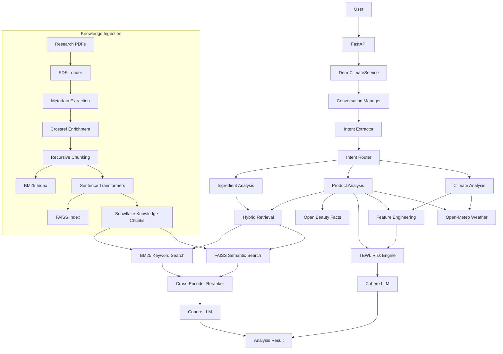

# DermClimate

DermClimate is a climate-aware skincare intelligence API. It brings together current weather conditions, a deterministic skin-barrier risk score, product and ingredient information, and retrieved dermatology literature to produce context-aware skincare analysis.

The application supports three analysis paths:

- **Climate analysis** explains how the current conditions in a city may affect the skin barrier.
- **Product analysis** evaluates a product's ingredients alongside the user's local climate and retrieved research.
- **Ingredient analysis** explains ingredients using retrieved dermatology literature.

The guiding design choice is to calculate the environmental risk in application code first, then use the language model to explain the result. The model is given structured inputs and retrieved evidence rather than being asked to invent the underlying risk assessment.

> **Project status:** This repository contains the Python API, analysis services, research-ingestion components, and retrieval pipeline. It does not currently contain a web frontend. Some setup and ingestion details need attention before a clean installation can run end to end; see [Implementation notes](#implementation-notes).

## Architecture

The high-level flow is:



You can also explore the generated repository diagram on [GitDiagram](https://gitdiagram.com/tanyaojha24/dermclimate).

### Request lifecycle

1. A request reaches `POST /chat`.
2. `DermClimateService` passes the message to `ConversationManager`.
3. `IntentExtractor` uses Cohere to turn the message into structured fields: intent, product, ingredients, concern, and city.
4. `ConversationManager` resolves missing information from the pending conversation state.
5. `IntentRouter` dispatches the request to the climate, product, or ingredient analysis service.
6. The selected service gathers the data it needs, performs deterministic calculations and/or retrieves research, and builds a prompt.
7. Cohere generates the natural-language explanation. The service returns an `AnalysisResult`, which the API serializes as JSON.

## Analysis workflows

### Climate analysis

The climate workflow fetches current weather data for the requested city through Open-Meteo. The current implementation uses:

- Temperature at 2 metres
- Relative humidity
- Wind speed at 10 metres
- Daily maximum UV index

`engineer_features()` assigns categories to humidity, temperature, UV, and wind. `TEWLRiskEngine` then calculates a score from 0 to 100 using the following configured ideal ranges:

| Variable | Range used by the risk engine |
|---|---:|
| Temperature | 18–22 °C |
| Relative humidity | 40–60% |
| UV index | 0–2 |
| Wind speed | 0–10 km/h |

The score weights humidity and UV deviations at 40% each, temperature at 15%, and wind at 5%. The engine labels this calculation `tewl-v1`.

The resulting weather categories and risk score are passed to the climate prompt. Cohere generates an explanation of the main contributing conditions and practical skincare considerations.

**Note:** This is the project's implemented heuristic risk score. It should not be interpreted as a clinically validated diagnostic or a medical measurement of transepidermal water loss (TEWL).

### Product analysis

The product workflow:

1. Requires a product or ingredient list and a city.
2. Fetches local weather and calculates the climate risk score.
3. If a product name is supplied, looks up its ingredient text through Open Beauty Facts.
4. Retrieves relevant research using both semantic and keyword search.
5. Reranks the retrieved passages with a cross-encoder.
6. Sends the ingredients, climate risk, and retrieved passages to the product-analysis prompt.
7. Returns Cohere's explanation with the risk assessment and retrieved documents.

### Ingredient analysis

The ingredient workflow:

1. Requires one or more ingredients.
2. Uses the ingredient names as a retrieval query.
3. Runs hybrid retrieval across FAISS and BM25.
4. Reranks the retrieved passages with a cross-encoder.
5. Passes the ingredients and retrieved research to the ingredient-analysis prompt.
6. Returns an explanation with the retrieved documents.

The prompt asks the model to discuss ingredient functions, evidence-supported benefits, possible drawbacks, and limitations in the available evidence.

## Research retrieval

DermClimate's retrieval pipeline combines two complementary search methods:

| Stage | Implementation | Role |
|---|---|---|
| Embeddings | `sentence-transformers/all-MiniLM-L6-v2` | Represents research chunks as vectors |
| Semantic retrieval | FAISS (`IndexFlatL2`) | Finds chunks with nearby embeddings |
| Keyword retrieval | BM25 | Finds chunks that share important query terms |
| Hybrid retrieval | `HybridKnowledgeRetriever` | Combines results from both retrievers |
| Reranking | `cross-encoder/ms-marco-MiniLM-L-6-v2` | Reorders candidate passages against the query |

Research chunks and their embeddings are stored in Snowflake. The FAISS and BM25 indexes are persisted locally under `indexes/` and loaded when the application starts.

## Research-paper ingestion

The ingestion components are designed to process dermatology research PDFs:

1. `PDFDocumentLoader` extracts text from each PDF.
2. `MetadataExtractor` attempts to identify the title, authors, journal, year, DOI, PMCID, and source URL.
3. `CrossrefMetadataEnricher` uses the DOI to retrieve publication metadata from Crossref when available.
4. `RecursiveChunker` splits extracted text into chunks (500 characters with 100 characters of overlap by default).
5. `SentenceTransformerEmbeddingModel` creates embeddings for the chunks.
6. `KnowledgeChunkBuilder` packages the text, source information, and embeddings.
7. `SnowflakeKnowledgeBaseStorage` stores the chunks. FAISS and BM25 builders create the retrieval indexes.

Research PDFs are not included in this repository. The `papers/README.md` file explains the intended paper placement and ingestion workflow.

## Repository layout

```text
dermclimate/
├── api/
│   ├── endpoints/
│   │   ├── chat.py                 # Chat endpoint
│   │   └── health.py               # Health-check endpoint
│   ├── dependencies.py             # FastAPI dependency access
│   ├── main.py                     # FastAPI application and lifespan
│   └── schemas.py                  # Request and response models
├── app/
│   ├── acquisition/                # Weather and product ingredient lookups
│   ├── ai/                         # Cohere client, intent extraction, prompts
│   ├── analysis/                   # Climate, product, and ingredient services
│   ├── conversation/               # Conversation state and context handling
│   ├── document_loader/            # PDF text extraction
│   ├── embedding/                  # Sentence Transformers embedding model
│   ├── features/                   # Weather feature engineering
│   ├── indexing/                   # Chunking and FAISS/BM25 index builders
│   ├── metadata/                   # Paper metadata extraction and enrichment
│   ├── models/                     # Domain and result data models
│   ├── persistence/                # Snowflake and local index storage
│   ├── rag/                        # Knowledge-base service
│   ├── reranking/                  # Cross-encoder reranking
│   ├── retrieval/                  # FAISS, BM25, and hybrid retrieval
│   ├── risk/                       # Skin-barrier risk calculation
│   └── ingest_paper.py             # Research-paper ingestion entry point
├── bootstrap/
│   └── application.py              # Dependency construction and wiring
├── data/
│   └── ingredients.json            # Ingredient data
├── indexes/                        # Persisted local retrieval indexes
├── metadata/
│   └── paper_metadata.csv          # Paper metadata
├── papers/                         # Add research PDFs here
├── scripts/
│   └── chat_cli.py                 # Command-line chat interface
├── sql/                            # Snowflake setup and metadata scripts
├── dermclimate_service.py          # Application service facade
├── requirements.txt
└── README.md
```

## Getting started

### Requirements

- Python 3.10 or newer
- A Cohere API key
- A Snowflake account with permission to create/use the configured database, schema, and warehouse
- Internet access for Open-Meteo, Open Beauty Facts, Crossref, Cohere, and model downloads

The current `requirements.txt` does not list every package imported by the application. Install the listed packages and the API/runtime dependencies explicitly:

```bash
git clone https://github.com/tanyaojha24/dermclimate.git
cd dermclimate

python -m venv .venv
```

Activate the environment:

```bash
# macOS / Linux
source .venv/bin/activate

# Windows PowerShell
.venv\Scripts\Activate.ps1
```

Install dependencies:

The checked-in `requirements.txt` in this repository snapshot is UTF-16 encoded. Convert it to UTF-8 before passing it to pip:

```bash
python -c "from pathlib import Path; p = Path('requirements.txt'); p.write_text(p.read_text(encoding='utf-16'), encoding='utf-8')"
python -m pip install --upgrade pip
pip install -r requirements.txt
pip install fastapi "uvicorn[standard]" pydantic rank-bm25
```

### Environment variables

Create a `.env` file in the repository root:

```env
COHERE_API_KEY=your_cohere_api_key
COHERE_MODEL=command-a-03-2025

SNOWFLAKE_USER=your_snowflake_username
SNOWFLAKE_PASSWORD=your_snowflake_password
SNOWFLAKE_ACCOUNT=your_snowflake_account
SNOWFLAKE_DATABASE=DERMCLIMATE
SNOWFLAKE_SCHEMA=PUBLIC
SNOWFLAKE_WAREHOUSE=your_snowflake_warehouse
```

`bootstrap/application.py` currently selects `command-a-03-2025` directly when constructing the Cohere client. The `COHERE_MODEL` setting is read by `app/config.py`, but is not currently used by that bootstrap code.

Do not commit `.env` or put API keys in source control.

### Snowflake setup

The application expects a `knowledge_chunks` table containing the research chunks and their embeddings. The repository includes a `setup_database()` helper that creates this table along with the project's other application tables.

After configuring `.env`, initialize the database objects with:

```bash
python -c "from app.persistence.snowflake_connector import setup_database; setup_database()"
```

The SQL scripts in `sql/` support the separate paper-metadata staging and loading workflow. Run them in the order indicated by their numeric prefixes when using that workflow.

### Run the API

From the repository root:

```bash
uvicorn api.main:app --reload
```

The API is available at `http://127.0.0.1:8000`.

Interactive API documentation:

- Swagger UI: `http://127.0.0.1:8000/docs`
- ReDoc: `http://127.0.0.1:8000/redoc`

Health check:

```bash
curl http://127.0.0.1:8000/health
```

Chat request:

```bash
curl -X POST "http://127.0.0.1:8000/chat" \
  -H "Content-Type: application/json" \
  -d '{"message": "How might today'\''s weather in Boston affect my skin barrier?"}'
```

Example response shape:

```json
{
  "status": "success",
  "response": "Analysis text generated by DermClimate...",
  "message": "Climate analysis completed successfully."
}
```

The exact response content depends on the live weather data and model output. If required details are missing, the API can return a `needs_input` status with a follow-up message.

### Run the command-line interface

The repository also includes a basic interactive CLI:

```bash
python -m scripts.chat_cli
```

Type `exit` to end the session.

## API reference

| Method | Path | Purpose |
|---|---|---|
| `GET` | `/health` | Returns the API health status |
| `POST` | `/chat` | Sends a message to the DermClimate conversation and analysis pipeline |

`POST /chat` accepts:

```json
{
  "message": "Analyze CeraVe Moisturizing Cream in Boston"
}
```

The response model contains:

| Field | Type | Description |
|---|---|---|
| `status` | string | Analysis status, such as `success` or `needs_input` |
| `response` | string or null | Generated analysis text |
| `message` | string or null | Status or follow-up message |

## Tests

The repository contains standalone test scripts for retrieval, reranking, metadata extraction, intent extraction, and product analysis. They are not currently organized as a configured pytest suite.

Run an individual script from the repository root, for example:

```bash
python test_hybrid_retrieval.py
python test_cross_encoder_reranking.py
python test_metadata_extractor.py
```

Some tests may require model downloads, API credentials, or a configured Snowflake database, depending on the component being exercised.

## Implementation notes

A few details in the current repository are worth knowing before running the full pipeline:

- `requirements.txt` in this repository snapshot is UTF-16 encoded and omits packages imported by the API and retrieval code, including FastAPI, Uvicorn, Pydantic, and `rank-bm25`. The installation commands above convert the file to UTF-8 and install the missing packages.
- The current `app/ingest_paper.py` constructs `KnowledgeBaseService` without all of the constructor arguments now required by that service. The ingestion entry point needs to be brought back into sync before it can be used as-is.
- The API initializes the knowledge base and retrievers during startup. A reachable Snowflake database with a populated `knowledge_chunks` table is therefore needed for the retrieval-backed application to initialize successfully.
- The API's conversation state is stored on the service instance created at startup. It is in-memory state, not persistent per-user conversation storage.
- The risk score is a project-defined heuristic (`tewl-v1`), not a clinically validated assessment.
- The product lookup depends on the product and ingredient data available through Open Beauty Facts. A product may not have a usable ingredient listing.

These notes describe the code in this repository snapshot and may change as the implementation evolves.

## Data and research sources

- [Open-Meteo](https://open-meteo.com/) — geocoding and weather data
- [Open Beauty Facts](https://world.openbeautyfacts.org/) — product and ingredient lookup
- [Crossref](https://www.crossref.org/) — publication metadata enrichment
- [Cohere](https://cohere.com/) — intent extraction and generated analysis
- [Snowflake](https://www.snowflake.com/) — research chunk storage

Research PDFs are not redistributed with the repository. Add only papers you are permitted to use, and follow each publisher's or repository's terms.

## Disclaimer

DermClimate is a software and research project for informational purposes. Its outputs are not medical advice, diagnosis, or a substitute for consultation with a qualified dermatologist. The climate risk score is an experimental heuristic and should not be used to make medical decisions.
